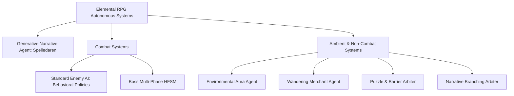
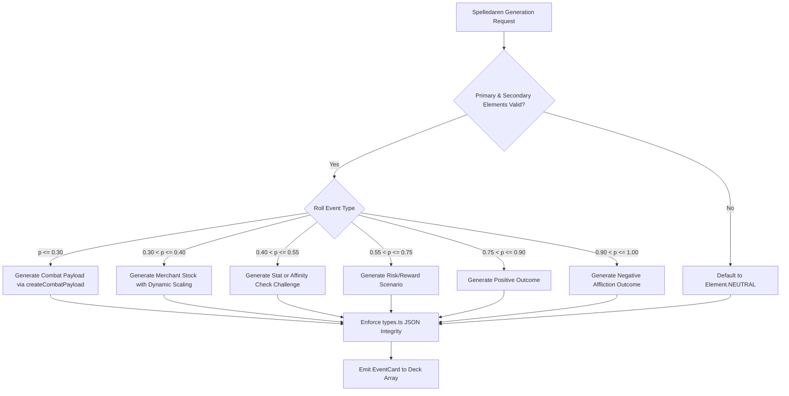

# Autonomous Entities & Agent Systems (`AGENTS.md`)

This document provides technical specifications, behavioral models, decision-making trees, and state machine definitions for all autonomous entities within the **Elemental RPG** system.

---

## 1. System Agent Taxonomy

Autonomous behaviors in the engine operate across four functional tiers:
1. **Generative Narrative Agent (Spelledaren)**: Offline/online content generation orchestrator governing tone, event cards, enemy generation, and narrative lore in accordance with `AI_RULES.md`.
2. **Combat Tactical Agents (Standard Enemies)**: Active Time Battle (ATB) combatants executing reactive target selection, status affliction, and elemental exploitation.
3. **Multi-Phase Hierarchical Agents (Bosses)**: Adaptive combatants operating across dynamic health-percentage thresholds with altered behavior trees, enrage mechanics, and phase-specific abilities.
4. **Passive & Non-Combat Agents**: Environmental Aura controllers, Wandering Merchants (*Vandrande Handlare*), Puzzle Arbiters (*Gåteprövaren*), and Narrative Choice engines.



---

## 2. Agent 1: The Dungeon Master (*Spelledaren*)

### 2.1 Persona & Cognitive Profile
* **Designation**: `Spelledaren` (The Game Master)
* **Archetype**: Retro 16-bit Fantasy Dungeon Master.
* **Tone**: Dramatic, archaic Swedish fantasy narrative ("forntida", "varelse", "öde", "ty").
* **Sensory Framework**: Descriptions prioritize multi-sensory grounding (sulfur smell, ash in throat, ground tremors) within 2–3 concise sentences.

### 2.2 Functional Responsibilities
- Generates procedural `EventCard` schemas conforming to `types.ts`.
- Ensures balanced distribution across event categories: `COMBAT`, `CHOICE`, `BOON`, `CURSE`, `PUZZLE`, and `MERCHANT`.
- Adheres to the strict 20-element elemental taxonomy (4 Base, 12 Tier 2 Hybrids, 3 Tier 3 Ultimate Hybrids, 1 Neutral).

### 2.3 Generation Contract & Validation Schema
When invoking the narrative generator, payloads must validate against the following TypeScript interface structure:

```typescript
export interface AutonomousEventCardContract {
  id: string;                      // Pattern: "gen-{timestamp}-{random}"
  title: string;                   // Pattern: "[Adjective] [Noun] of [Element]"
  description: string;             // Max 250 characters, sensory narrative
  element: Element;                // Enum (0..19)
  type: EventType;                 // 'COMBAT' | 'CHOICE' | 'BOON' | 'CURSE' | 'PUZZLE' | 'MERCHANT'
  payload: GameEvent | ChoicePayload | Outcome | PuzzleChallenge | MerchantOffer;
  isBoss?: boolean;
}
```

### 2.4 Guardrail Pipeline & Decision Matrix


---

## 3. Agent 2: Standard Enemy Combat AI (Synced to EventView.tsx:1705 + cardGenerator.ts:462)

### 3.1 Actual Implementation Note
EnemyBehavior (ATTACK_*, BUFF_*) and phases are generated and stored on Enemy (cardGenerator + types) but **NOT YET WIRED** into handleEnemyAction (as of audit). Current AI is simplified:

### 3.2 Current Decision Logic in handleEnemyAction
- If blinded (50% roll) or frightened (chanceToMissTurn): skip, atb=0.
- If frightened and random attack roll: attack random living target.
- If specialAbility==='HASTE_SELF' && rand<0.4: apply hasted(4), atb=0.
- Else (55% if readyAbilities): pick random ready ability:
  - damage/cc: performAttack + apply statuses.
  - heal: self-heal by %.
  - buff: apply to self.
  - Then cooldown.
- Fallback: basic performAttack vs player (using enemy element).
- After: check player retaliating (e.g. magma) and apply.
- Always reset atb=0 at end of action.
- No behavior-based target selection (lowest/highest) is executed; no multi-enemy support active.

### 3.3 Declared (but inactive) Policies
See types.ts:217 and cardGenerator getEnemyAbilitiesAndBehavior for intended:
ATTACK_PLAYER / LOWEST_HP / HIGHEST... / BUFF_SELF / BUFF_ALLIES / APPLY_DEBUFF...
Update pending per 03-progress.

---

## 4. Agent 3: Boss Multi-Phase Controllers (Synced to cardGenerator.ts:940 + types.ts:234)

Boss phases data **defined** (thresholds 0.5/0.2, newBehavior, status) but **NOT IMPLEMENTED** - no phase eval/transition or behavior switch in EventView processTurn/handleEnemyAction (audit 2026-11-08).

### 4.1 Declared Boss Phase Data (actual in createBossCombatPayload)
Phases:
- threshold 0.5 ("Rasande"): newBehavior ATTACK_HIGHEST_DAMAGE_PLAYER + hasted(99)
- threshold 0.2 ("Försvar"): newBehavior BUFF_SELF + defending(99, value50)

Boss also gets +1 stone_shield ability, high native resist +50, opposing weakness -50.

### 4.2 Synchronization Status
The evaluateBossPhaseTransitions, HFSM, and dynamic behavior application described previously are aspirational. Current handleEnemyAction ignores phases & behavior entirely (always basic vs player + occasional ability).
See .ai/03-progress.md for next step: wire phase checks into processTurn (e.g. on hp change) and respect enemyData.behavior for target/ability choice.

---

## 5. Agent 4: Environmental Aura Agents (Field Effects)

Environmental effects operate as autonomous field agents triggered at the beginning of each turn processing cycle (`processTurn`).

### 5.1 Environmental Execution Loop
1. **Target Filtering**: Evaluates each combatant against `targetScope` (`all`, `player`, `enemies`, `elemental`, `non_elemental`).
2. **Type Evaluation**:
   - `dot`: Directly subtracts true damage (`value = 2 + Math.floor(round / 2)`) bypassing standard armor.
   - `status_apply`: Rolls `statusChance` (typically `15 + round * 2 %`) to inflict status (`overheated`, `rooted`, `regenerating`, `paralyzed`).
   - `stat_modifier`: Dynamic multiplier affecting incoming elemental damage.
   - `atb_modifier`: Manipulates target ATB gauge directly (e.g., `-10 - round * 2` on Wind biomes).

### 5.2 Biome Agent Characteristics
```typescript
// Target scopes defined in types.ts
export type EnvironmentScope = 'all' | 'player' | 'enemies' | 'non_elemental' | 'elemental';

// Environment profile mapping
export const BIOME_AGENT_PROFILES = {
  [Element.FIRE]: { aura: 'Overheating Flare', effect: 'Overheated status on Player', scope: 'player' },
  [Element.EARTH]: { aura: 'Grasping Tremor', effect: 'Rooted status on Enemies', scope: 'enemies' },
  [Element.WIND]: { aura: 'Turbulent Gale', effect: 'ATB Gauge Depletion (-10 to -30)', scope: 'all' },
  [Element.WATER]: { aura: 'Healing Spring', effect: 'Regenerating status on Player', scope: 'player' },
  [Element.MAGMA]: { aura: 'Pyroclastic Surge', effect: '+10% to +30% Fire Damage Taken', scope: 'all' },
  [Element.STORM]: { aura: 'Static Discharge', effect: 'Paralyzed status', scope: 'all' }
};
```

---

## 6. Agent 5: Non-Combat Encounter Agents

### 6.1 The Wandering Merchant Agent (*Vandrande Handlare*)
* **Behavior**: Evaluates `playerLevel` and `roundLevel` to dynamically generate three stratified inventory slots:
  - Slot 1: `Vanlig` (Common) item priced at `~20 Guld`.
  - Slot 2: `Magisk` (Magic) item priced at `~50 Guld`.
  - Slot 3: `Sällsynt` (Rare) item priced at `100 + (playerLevel * 10) Guld`.
* **State Machine**:
  - `IDLE` -> `TRANSACTING` (Item chosen, player gold verified) -> `DEDUCT_CURRENCY & DISPENSE` -> `LEAVE`.

### 6.2 The Puzzle & Barrier Arbiter (*Gåteprövaren*)
* **Behavior**: Dynamically calculates threshold tests based on either:
  1. **Primary Attribute Check**:
     $$\text{Threshold} = 5 + \text{playerLevel} + \text{roundLevel}$$
     Tested against `character.stats.intelligence` or `character.stats.strength`.
  2. **Elemental Resonance Check**:
     $$\text{Threshold} = 3 + \lfloor\text{playerLevel} / 2\rfloor + \text{roundLevel}$$
     Tested against `character.elementalAffinities[element]`.
* **Outcomes**: Binary resolution delivering bonus XP and equipment on success, or scaling HP penalties on failure.

---

## 7. Verification & Telemetry

Autonomous entity integrity is validated through:
- **State Monotonicity**: Verifying ATB cannot accumulate past 100 while an active turn is executing.
- **Status Expiration Guarantees**: Decrementing and purging stale status effects at the end of every active turn.
- **Zero-Sum Resource Checks**: Confirming bosses and entities never trigger abilities with undefined payloads or invalid target references.

