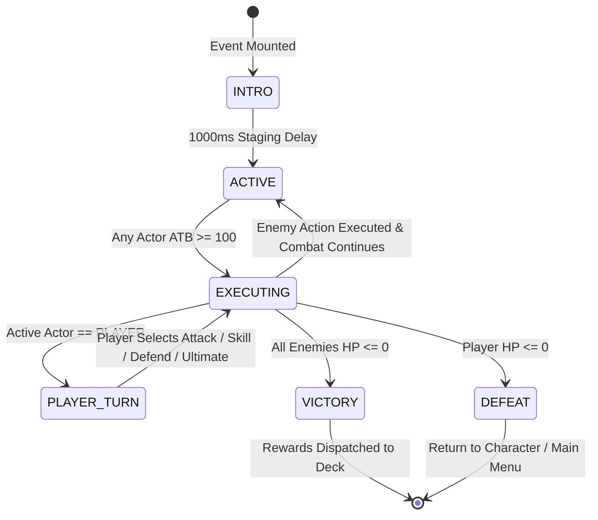
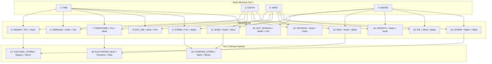
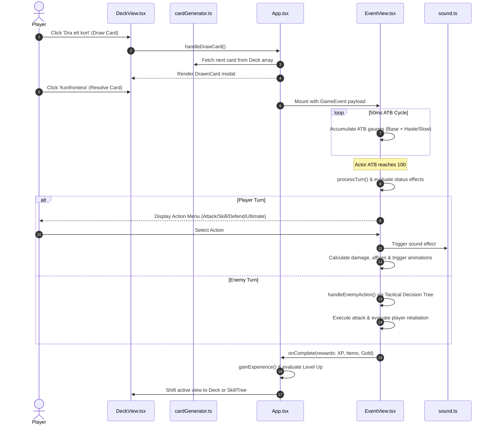

# System Architecture & Technical Design (`ARCHITECTURE.md`)

This document outlines the software architecture, design patterns, data flows, module dependencies, and type hierarchies of the **Elemental RPG** project.

---

## 1. High-Level Architectural Overview

Elemental RPG is a client-side, 16-bit retro RPG combining an **Active Time Battle (ATB)** combat engine, a **deck-based roguelike exploration loop**, and a **20-element node-based skill tree**. Built with **React 19**, **TypeScript**, **Tailwind CSS**, **Vite**, and **Capacitor**, it operates as a responsive web app and a native cross-platform mobile shell (Android/iOS).

```mermaid
graph TB
    subgraph Client Application Layer
        UI[React UI Components]
        Renderer[Pixel Graphics & SVG Renderer]
        Audio[ZzFX Procedural Audio Synthesizer]
        VFX[tsParticles & Visual Effects Layer]
    end

    subgraph State Management & Game Loops
        AppCore[App.tsx State Orchestrator]
        ATBEngine[ATB Combat Tick Loop]
        DeckEngine[Procedural Deck & Event Resolver]
        ProgressionEngine[XP, Level, & Affinity Evaluator]
    end

    subgraph Domain Models & Data
        Types[types.ts: Core Contracts & Enums]
        Constants[constants.tsx: Affinities, Skills, Archetypes]
        CardGen[cardGenerator.ts: Procedural Factory]
    end

    subgraph Platform Abstraction
        CapCore[@capacitor/core]
        CapAndroid[@capacitor/android]
        CapiOS[@capacitor/ios]
    end

    UI --> AppCore
    AppCore --> ATBEngine
    AppCore --> DeckEngine
    AppCore --> ProgressionEngine

    ATBEngine --> Audio
    ATBEngine --> VFX
    UI --> Renderer

    DeckEngine --> CardGen
    CardGen --> Constants
    CardGen --> Types
    ProgressionEngine --> Constants
    AppCore --> Types

    Client Application Layer --> Platform Abstraction
```

---

## 2. Core Design Patterns

### 2.1 Finite State Machine (FSM)
The combat subsystem in `EventView.tsx` is structured as a deterministic finite state machine with strict transition guards:



### 2.2 Active Time Battle (ATB) Tick Engine
Rather than relying on classic turn-order queues, combatants accumulate action gauge points dynamically via a high-frequency interval timer (see EventView.tsx:441):

```ts
let atbRate = 1.5;
if (isHasted) atbRate *= 1.5;
if (isSlowed) atbRate *= 0.5;
const newAtb = actor.atb + atbRate;
```
* $\Delta_{\text{base}} = 1.5$ per $50\,\text{ms}$ tick (setInterval).
* $M_{\text{haste}} = 1.5$ (cumulative *=) if `hasted`; $M_{\text{slow}} = 0.5$ if `slowed`.
* Initial: player atb=0, enemies random()*50.
* Post-action: atb set to 0; tick pauses while any actor.atb >=100.
* Matches types.ts Enemy + EventView perform/process logic exactly.

### 2.3 Factory Pattern (`cardGenerator.ts`)
Decouples scenario composition from runtime UI. The generator acts as an abstract factory producing typed `EventCard` instances (`COMBAT`, `CHOICE`, `BOON`, `CURSE`, `PUZZLE`, `MERCHANT`) scaled to `playerLevel` and `roundLevel`.

### 2.4 Strategy Pattern (Elemental Affinities & Abilities)
Combat actions, affixes, and passive perks utilize polymorphic effect handlers evaluated via discriminated unions:
- `PASSIVE_TALENT`: Handles triggers like `COUNTER_ATTACK`, `HEAL_BONUS`, `RESOURCE_GAIN`, and `APPLY_STATUS`.
- `ULTIMATE_ABILITY`: Dispatches strategies such as `AOE_DAMAGE`, `MASS_HEAL`, `GLOBAL_BUFF`, and `SINGLE_TARGET_DAMAGE`.

---

## 3. The 20-Element Synthesis Matrix

The magic system is governed by a 4-tier elemental ontology implemented in `types.ts` (`enum Element`):



### 3.1 Elemental Damage & Resistance Mathematics
Matches EventView.tsx:performAttack + cardGenerator create* (resistances built per primary elem) + types Enemy:

```ts
const resistanceValue = ... (enemyData.resistances[damageElement] || 0);
let resistanceMultiplier = 1 - (resistanceValue / 100);
...
let finalDamage = Math.floor(Math.max(1, (damage - armor) * resistanceMultiplier) * (isDefending ? 0.5 : 1));
```
* Positive R = resist (e.g. +50 for boss native), negative = weakness (e.g. -50).
* Hybrid gen matrix (cardGenerator.ts:15): only FIRE/EARTH/WIND/WATER pairs -> MAGMA/STEAM etc; others fallback to primary. Matches ARCH diagram intent. Affinity bonuses (constants ELEMENTAL_AFFINITY_BONUSES) separate from combat R.

---

## 4. Player Archetype & Resource Engines

Each archetype leverages a distinct resource mechanic that redefines turn-to-turn strategy:

| Archetype | Native Element | Special Resource | Mechanics & Rules |
| :--- | :--- | :--- | :--- |
| **Pyromanten** | `Element.FIRE` | **Hetta** | • Skills **generate** Hetta instead of consuming it.<br>• Attacks decay by $10$ Hetta per turn.<br>• When Hetta reaches max capacity, player suffers an **Overheat Explosion** ($20\%$ max HP self-damage + 2 turns `overheated`). |
| **Stenväktaren** | `Element.EARTH` | **Styrka** | • Accumulates $+15$ Styrka when struck by incoming attacks.<br>• Accumulates $+25$ Styrka on active `DEFEND`.<br>• Expends Styrka to activate high-armor shields and seismic crowd control. |
| **Stormdansaren** | `Element.WIND` | **Energi** | • Passive turn-based regeneration ($+25$ Energi per player turn).<br>• High-dexterity scaling yielding accelerated ATB tick rates and evasion buffs. |
| **Tidvattenvävaren** | `Element.WATER` | **Flöde** | • Generates $+30$ Flöde when executing healing or crowd-control spells.<br>• Reaching maximum Flöde triggers **Full Flow** status, making the next ability completely cost-free and empowered. |

---

## 5. End-to-End Data Flow



---

## 6. Detailed Component Map & Architecture

```
H:\Elementalerna\
├── index.html                  # HTML5 entry point with Retro viewport & Tailwind
├── index.tsx                   # React 19 root bootstrap mounting App into #root
├── App.tsx                     # Top-level state container, active view router
├── types.ts                    # Canonical data interfaces, discriminated unions, enums
├── constants.tsx               # Static content (Skills, Archetypes, Icons, Affinities)
├── sound.ts                    # ZzFX procedural audio synthesizer module
├── index.css                   # Tailwind CSS, custom pixel borders, keyframe animations
├── utils/
│   └── cardGenerator.ts        # Procedural deck, encounter, and item factory
├── components/
│   ├── MainMenu.tsx            # Title screen & run initializer (Active in App.tsx)
│   ├── CharacterSelection.tsx  # 4 Archetype selector with bonus display
│   ├── DeckView.tsx            # 8-card round deck controller with card draw modal
│   ├── EventView.tsx           # Monolithic ATB Combat engine & event arbiter (~2573 LOC)
│   ├── SkillTree.tsx           # 20-element interactive graph visualizer
│   ├── SkillNode.tsx           # SVG node element with connection lines & rank counters
│   ├── CharacterSheet.tsx      # Stat allocation, equipment slots & affinity thresholds
│   ├── Inventory.tsx           # 40-slot equipment grid with rarity borders
│   ├── ItemTooltip.tsx         # Context-sensitive hover card for item affixes
│   ├── ElementalAffinities.tsx # 20-element threshold unlock viewer (1–50)
│   ├── ElementalAffinityButton.tsx # Interactive element investment button with progress
│   ├── CombatBackground.tsx    # Dynamic biome visual backdrop based on element
│   ├── AnimatedElementalBackground.tsx # Background canvas particle effects
│   ├── Footer.tsx              # Bottom navigation bar switching active views
│   ├── Tooltip.tsx             # Generic hover tooltip helper
│   └── DebugView.tsx           # Developer telemetry & cheat console
└── src/components/
    ├── ElementalTextEffects.tsx # Particle emitter text visualizer (Experimental)
    └── MainMenu.tsx            # Variant MainMenu utilizing ElementalTextEffects
```

---

## 7. Platform Packaging Architecture (Capacitor)

The codebase incorporates Capacitor 7 tooling (`capacitor.config.ts`) targeting iOS and Android builds:
* `appId`: `com.example.elementalerna`
* `appName`: `Elementalerna`
* `webDir`: `dist`

The Vite production build bundles static JavaScript, CSS, and HTML assets into `dist/`, which are mirrored directly into the native web views of Android Studio and Xcode projects without external server dependencies.
