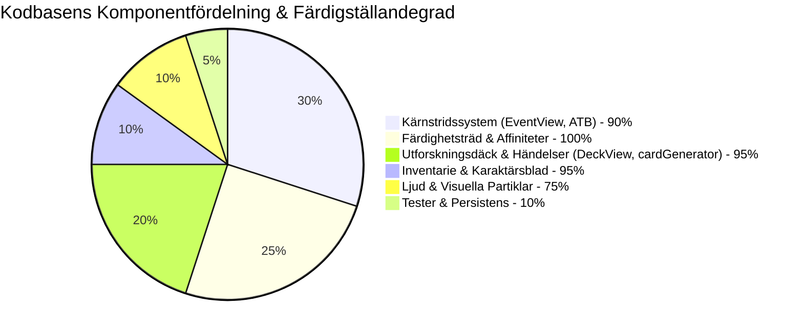

# Projektstatus & Teknisk Exekutiv Sammanfattning (`PROJECT_STATUS.md`)

*Senast uppdaterad: November 2026 | Status: v0.5.0-beta | Plattform: Webb & Mobil (Capacitor)*

---

## 1. Exekutiv Översikt & Hälsorapport

**Elemental RPG** (`Elementalerna`) är en 16-bitars retro-inspirerad RPG-applikation byggd med **React 19**, **TypeScript**, **Tailwind CSS**, **Vite** och **Capacitor**. Kärnupplevelsen förenar ett Active Time Battle (ATB) realtidsstridssystem, procedurgenererad kortbaserad utforskning och ett 20-elements nodbaserat färdighetsträd.



### Övergripande Systemhälsa

| Område | Betyg | Detaljerad Status |
| :--- | :---: | :--- |
| **Kärnspelmekanik (Core Loop)** | 🟢 **Komplett** | Karaktärsskapande, 8-korts däck per omgång, boss-möten, ATB-strider, belöningar och progression fungerar fullt ut. |
| **Magisystem (20 Element)** | 🟢 **Komplett** | 4 grundelement, 12 hybridgrenar, 3 ultimata hybrider och neutralt element är fullt integrerade med passiva och ultimata förmågor. |
| **Datapersistens (Save State)** | 🟢 **Löst** | Komplett save.ts + load/restore i App.tsx (localStorage, roundLevel/gold/char/equip persist). |
| **Ljudarkitektur (Audio Engine)** | 🟡 **Ej löst** | Fortfarande `new AudioContext()` per zzfx-anrop i sound.ts (ingen singleton). |
| **Automatiserad Testtäckning** | 🟡 **Delvis** | Endast node --test (validateSave, playerCombatStats) + manuella/e2e .cjs; inget vitest/npm test; ej 20/20 combat-tester. |
| **Bygg- & Kompileringsstatus** | 🟢 **Stabil** | TypeScript strikt; core körs. |
| **Prestanda & Rendereffektivitet** | 🟡 **Kräver Åtgärd** | 50ms ATB setInterval i EventView.tsx (~2573 rader) orsakar full re-renders. |
| **Arkitektur & Modularitet** | 🔴 **Teknisk Skuld** | Monolitisk EventView; + boss.phases & enemy.behavior definierade i cardGenerator/types men helt oimplementerade i combat (stora gap). |

---

## 2. Detaljerad Komponent- & Modulstatus

### 2.1 Rotfiler & Konfiguration
| Fil | Storlek | Status | Beskrivning & Noteringar |
| :--- | :--- | :---: | :--- |
| `App.tsx` | 21.0 KB | 🟢 Klar | Central router och tillståndshanterare (`character`, `equipment`, `deck`, `inventory`, `gold`, `roundLevel`). |
| `types.ts` | 12.9 KB | 🟢 Klar | Typdefinitioner för 20 element, 22 statuseffekter, kort, fiender, föremål och stridshändelser. |
| `constants.tsx` | 72.9 KB | 🟢 Klar | Statisk data: färdighetsträd, 20-elements affinitetströsklar (1–50), arketyper, SVG-pixelikoner. |
| `sound.ts` | 3.5 KB | 🟡 Åtgärd | ZzFX-mikrosynt. Behöver singleton-hantering av `AudioContext`. |
| `index.css` | 31.2 KB | 🟢 Klar | Tailwind-stilar, pixelkanter (`pixelated-border`), animationer (`animate-pulse-glow`, `animate-hit-flash`). |
| `index.html` | 1.0 KB | 🟡 Åtgärd | Innehåller dubbla `<script src="index.tsx">` samt CDN-importmappar som bör städas. |
| `capacitor.config.ts` | 0.2 KB | 🟢 Klar | Konfigurerad för iOS/Android under `com.example.elementalerna`. |
| `vite.config.ts` | 0.7 KB | 🟢 Klar | Vite 6 + React-plugin + `@dyad-sh/react-vite-component-tagger` + Gemini API env-injektion. |

### 2.2 Komponenter (`/components` och `/src/components`)
| Komponent | Rader / Storlek | Status | Ansvar & Arkitektonisk Bedömning |
| :--- | :--- | :---: | :--- |
| `EventView.tsx` | ~2573 rader | 🔴 Monolit + Debt | Hanterar ATB+strid; saknar boss phase + behavior impl. |
| `DeckView.tsx` | 178 rader / 9.8 KB | 🟢 Klar | Interaktiv kortlekshantering med draghög, kasthög och händelseaktivering (Strid, Val, Gåta, Handlare). |
| `SkillTree.tsx` & `SkillNode.tsx` | ~300 rader / 9.4 KB | 🟢 Klar | Koordinatbaserat nodträd med SVG-anslutningslinjer, rankuppgraderingar och förutsättningskontroller. |
| `CharacterSheet.tsx` | 260 rader / 14.7 KB | 🟢 Klar | Karaktärsstatistik, attributökningar, utrustningsplatser och affinitetströskelinspektör. |
| `Inventory.tsx` & `ItemTooltip.tsx` | ~180 rader / 7.1 KB | 🟢 Klar | 40 slots rutnätslager med sällsynthetsfärgning (`Vanlig`, `Magisk`, `Sällsynt`, `Legendarisk`) och verktygstips. |
| `ElementalAffinities.tsx` | 85 rader / 3.0 KB | 🟢 Klar | Inspektör för tröskelbelöningar (passiva talanger och ultimata krafter) per element. |
| `CharacterSelection.tsx` | 100 rader / 4.2 KB | 🟢 Klar | Arketypval för *Pyromanten*, *Stenväktaren*, *Stormdansaren* och *Tidvattenvävaren*. |
| `MainMenu.tsx` | 38 rader / 1.9 KB | 🟢 Klar | 16-bitars retrostartmeny med animerad rubrik och startknapp. |
| `CombatBackground.tsx` | 40 rader / 1.3 KB | 🟢 Klar | Dynamisk biomvisning baserad på stridens element (vulkan, gruva, flygande öar, ruiner). |
| `AnimatedElementalBackground.tsx` | 70 rader / 2.3 KB | 🟡 Prestanda | Partikelbakgrund via `@tsparticles/react`. Kräver prestandabegränsning på mobila enheter. |
| `DebugView.tsx` | 65 rader / 2.0 KB | 🟢 Klar | Fusk- och testkonsol för guld, XP, hälsa och kortdragning. |
| `src/components/ElementalTextEffects.tsx`| 198 rader / 6.2 KB | 🟢 Separat | Experimentell emitter-partikeltextkomponent för rubriker. |

### 2.3 Verktyg & Fabriker (`/utils`)
| Fil | Rader / Storlek | Status | Beskrivning |
| :--- | :--- | :---: | :--- |
| `cardGenerator.ts` | 644 rader / 31.3 KB | 🟢 Klar | Procedurgenerator för händelsekort, bossar, fiendemotstånd/svagheter, miljöeffekter och föremålsaffixer. |

---

## 3. Teknisk Skuldsanalys & Riskregister

```mermaid
graph LR
    subgraph Kritiska Risker (P0)
        R1[Ingen Automatiserad Testning] --> Impact1[Hög risk för regressionsfel vid formeländringar]
        R2[Volatilt Speltillstånd i Minnet] --> Impact2[All data förloras vid sidomladdning eller app-växling]
    end

    subgraph Höga Risker (P1)
        R3[50ms Renderingskaskad i EventView] --> Impact3[Batteridränering och hackig bildfrekvens på mobiler]
        R4[AudioContext Minnesläcka i sound.ts] --> Impact4[Ljudet dör efter upprepade ljudeffekter]
    end

    subgraph Medelstora Risker (P2)
        R5[Monolitisk Filstruktur] --> Impact5[Svåröverskådlig kod och komplex samutveckling]
        R6[Dubblerade Skripttaggar i index.html] --> Impact6[Risk för dubbelinitiering i vissa webbläsare]
    end
```

### Detaljerad Riskbedömning (Uppdaterad efter audit)

1. **Ofullständig fiende-AI & Bossfaser (P0 - Kritisk)**:
   - *Nuvarande läge*: enemy.behavior och phases[] genereras (cardGenerator:462,940) men ignoreras i EventView handleEnemyAction (alltid basic attack + random ability).
   - *Åtgärd*: Implementera phase-transition check + respect behavior i handleEnemyAction (se AGENTS.md sync).

2. **Prestandahinder i Strid (P1 - Hög)**:
   - *Nuvarande läge*: `setInterval(..., 50)` (EventView:463) + full setActors orsakar re-renders.
   - *Åtgärd*: Ref-baserad ATB eller isolerade bar-komponenter.

3. **WebAudio Resursutmattning (P1 - Hög)**:
   - *Nuvarande läge*: `new AudioContext()` per ljud i sound.ts zzfx. (Korrekt: INTE fixat trots tidigare doc-claims).
   - *Åtgärd*: Singleton + resume.

4. **Test- & Dokumentationssynk (P2)**:
   - *Läge*: Tester partiella; många docs (OPT/DEVLOG/PROJECT) hade felaktiga "Complete" för sound/save/tests/LOC.
   - *Åtgärd*: Audit-sync (done), lägg till vitest + unit för damage/resist.

---

## 4. Åtgärdsplan & Sprintprioriteringar

### Sprint 6 (Pågående): Prestanda & Refaktorisering (audit-uppdaterad)
- [x] Kodbasanalys + dokumentationssync (AGENTS/ARCH/PROJECT/.ai) - denna audit.
- [ ] Singleton AudioContext i sound.ts (fortfarande per-call).
- [x] Save i save.ts + App (löst).
- [ ] Optimera 50ms ATB.
- [ ] Implementera boss phases + enemy behavior i EventView (kritisk debt).

### Sprint 7 (Kommande): Testning & Modularisering
- [ ] Konfigurera **Vitest** som automatiserad testlöpare i `package.json`.
- [ ] Skriv enhetstester för skadeberäkningar, motståndsmultiplikatorer och arketypresurser.
- [ ] Bryt ut `EventView.tsx` till separata moduler (`CombatArena.tsx`, `ActorSprite.tsx`, `ActionMenu.tsx`, `CombatLog.tsx`).

### Sprint 8 (Framtida): Modularisering & Mobilsäkring
- [ ] Bryt ut `EventView.tsx` till separata moduler:
  - `CombatArena.tsx` (bakgrund och layout)
  - `ActorSprite.tsx` (stridande enhet, animation och hälsobalk)
  - `ActionMenu.tsx` (attack, förmågor, försvar, ultimat)
  - `CombatLog.tsx` (stridslogg och meddelandehistorik)
- [ ] Verifiera Capacitor-byggen på Android Studio och iOS Xcode med notch-anpassning.
- [ ] Integrera valfri AI-generering via Gemini API för dynamisk Spelledar-dialog och unika händelsekort.

---

## 5. Slutsats & Produktionsberedskap

Projektet har en exceptionellt välgenomtänkt speldesign, en komplett och balanserad 20-elements magiskala, distinkta spelarketyper och en fungerande retro-spelupplevelse. Genom att adressera de identifierade prestandaflaskhalsarna, etablera en automatiserad testsvit och införa datapersistens kommer applikationen att uppnå full kommersiell och mobil produktionsstandard.
